# Drift

Drift is an Omarchy plugin, built with [lunatui](https://github.com/moonbase2090/lunatui), that shows how local Hyprland and Omarchy configuration compares to the templates shipped in the installed `omarchy` package.

After an Omarchy update, or any time, it reports which files under `~/.config/hypr` and `~/.config/omarchy` still match those templates, which are local overrides, and which conflict with a newly shipped upstream change. It is meant to replace the all-or-nothing `omarchy-refresh-*` commands with a file-by-file review.

**Status:** read-only scan, status and file diff commands are available. The review screen scans on a worker thread and shows the result as a tree. The product brief is `docs/PRD.md`.

## Documentation

- [User guide](docs/guide.md): what Drift tracks, how bases are found (including the first update), the screens and keys, resolving a conflict, the safety model, recovering from backups and uninstalling.
- [Command reference](docs/cli.md): every command, flag and exit code.
- [Bar widget](docs/widget.md).
- [Keys and mouse targets](docs/input-map.md).

The commands in these pages are run by a test against a fixture system.

## Review screen

`drift` opens a screen with a header, a path tree, and the key hints taken from the keymap. While a scan is running the tree shows a scanning row, and the rest of the screen still takes input. Press `r` to scan again. A change under a tracked root starts one follow-up scan after a short pause, including when many changes arrive together. Press `q`, or click Quit, to leave. The terminal is restored when the screen closes. The screen follows the terminal when its size changes, whichever screen or dialog is open, and repaints at the new size.

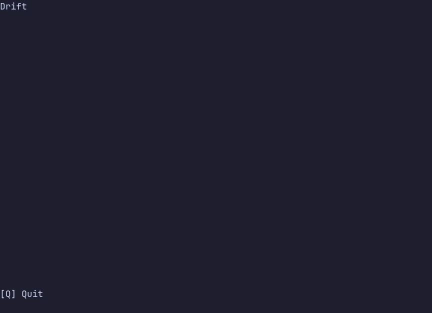

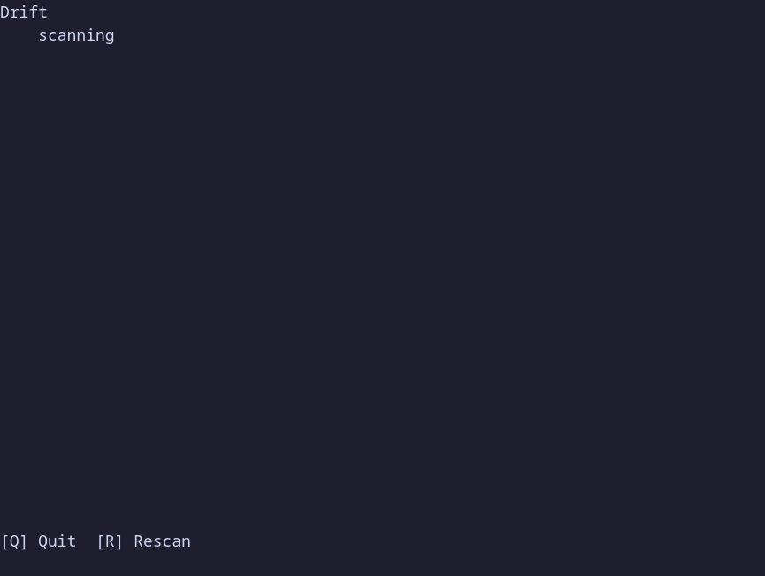

`drift --snapshot` prints one 80×24 frame and does not take the terminal. Pass `--width` and `--height` together to print another size.

A changed file opens in five columns once the window is at least 200 cells wide, wide enough for each text pane to keep about 40 cells: the hunk list, then base, ours, theirs, and the result. The four text panes share one scroll position. `n` and `p` move between hunks, Tab moves focus, and `[` / `]` or a drag resizes the focused pane.

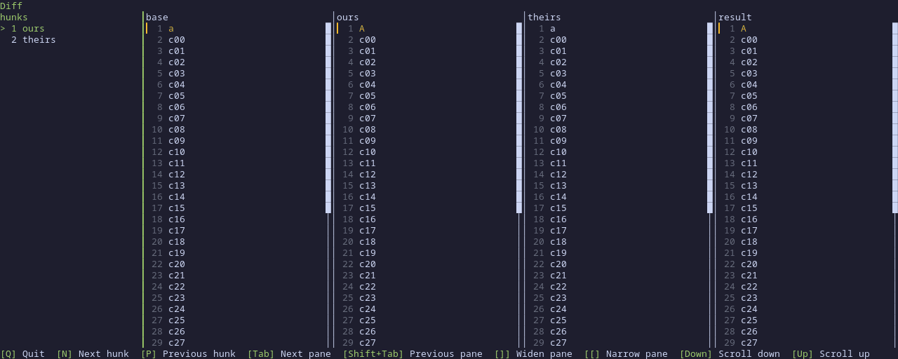

Below 200 columns the same file uses fewer panes, so paths and lines are not cut mid-word in narrow columns; `v` can still force the five columns. From 100 columns it shows ours and theirs side by side, with the result underneath. Narrower than that, the rows stack in one column. A removed line keeps a minus mark, an added line keeps a plus mark, and a conflict shows ours and theirs. `v` cycles those layouts. A resize that crosses a width boundary follows the width again and keeps the selected hunk. A file with no base stays on two panes, and the header says the base is unknown.

The Omarchy menu opens Drift with app id `TUI.float`. Omarchy floats and centers that class at 875×600. Stock Foot, with JetBrains Mono at 9pt and 14px of padding, measures 121×33 cells in that window, which is the two-pane layout. Maximizing reaches four panes at 200 columns, or with `v` below that. Drift does not add its own window rule.

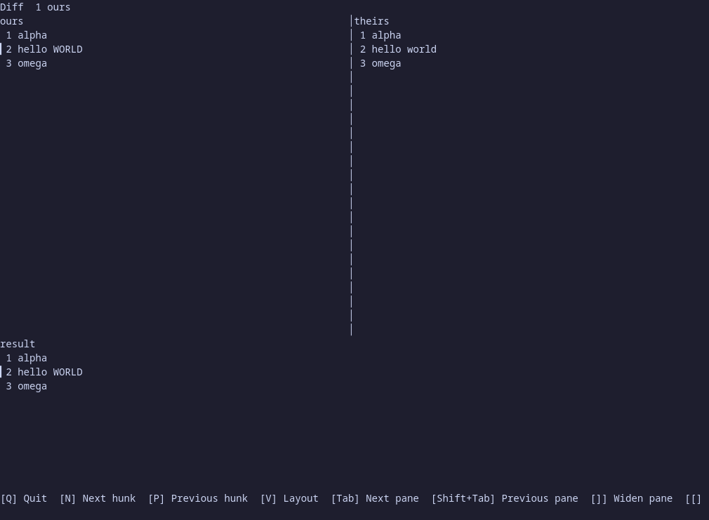

The capture below is the real program in a 170-column terminal, where five columns would leave each text pane about 35 cells wide. The conflict opens as two panes with the result underneath, and `v` twice forces the five columns, with their cut-off lines.

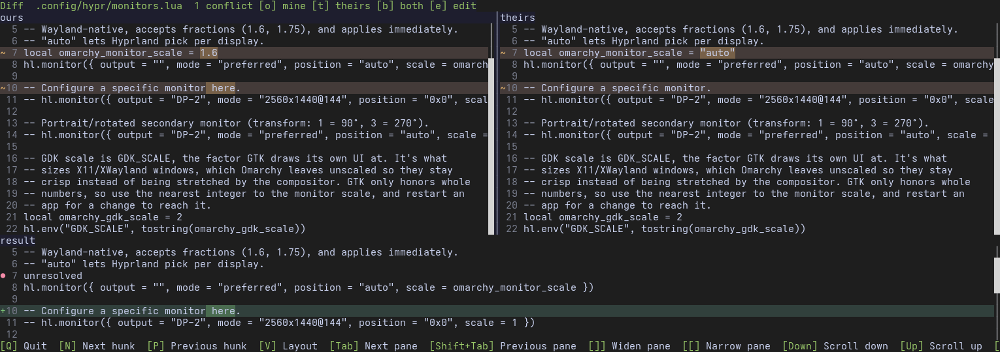

Changed lines are tinted across the whole row, like a git diff. In the two-pane view a line only ours has is green with a `+` in the gutter, a line only theirs has is red with a `-`, and a line changed on both sides is yellow with a `~`. The exact changed characters get a stronger tint of the same color. Where one side has no line, a blank filler row keeps the two panes level and takes no line number. Four-pane, stacked and result views use the same marks. The colors come from the active Omarchy theme (`colors.toml` in its state directory) and fall back to fixed readable colors when no theme is found.

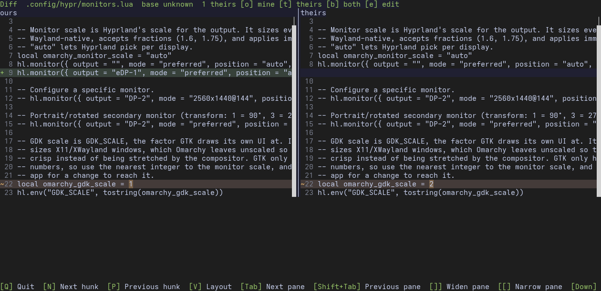

`o` keeps the selected hunk's ours text, `t` takes theirs, `b` keeps both, and `e` edits that hunk. The result pane updates immediately. `w` opens the plan once every conflict is chosen. An unresolved conflict stays in the result pane and `w` explains why it will not open the plan.

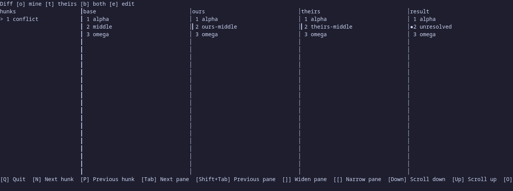

## Plan dialog

Before anything is written, the plan dialog lists every file with its action, the backup location and a diff summary, and the old transactions that will be pruned. The time under the title is local, with a numeric offset. Focus starts on Cancel. `d` expands the selected file's diff, Tab moves between the buttons, `y` confirms, `n` or Escape cancels, and the mouse works on the buttons and rows. The capture below is the real program: `cargo run -p drift-tui --example plan_dialog` opens the dialog on a sample plan and writes nothing; here it expands the first diff, the second diff, moves focus to Confirm and confirms.

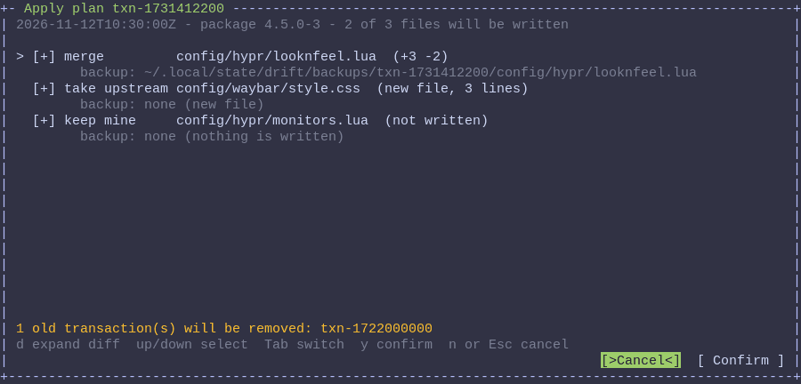

A file you chose to keep is not written, but `d` still shows how the shipped template differs from your file, under a line saying your file is kept; the dry run prints the same diff. The capture is the real program: it keeps one local override and expands it.

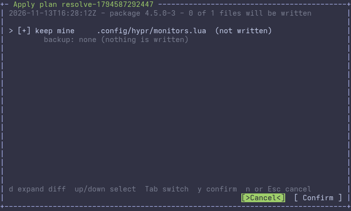

## Tree screen

`drift` scans the installed package against your files and shows the result as a path tree. Directories start collapsed, except the ones on the path to the first drifted or overridden file, so a deep folder that does not need review stays out of the way. Every file has a glyph, its status label and a colour, so no status depends on colour alone; the header counts each status and doubles as the filter buttons. `j` and `k` move, `h` and `l` collapse and expand, `1`-`6` filter by status and `0` clears, `/` searches as you type, `Space` marks and `a` marks everything in the filter. The mouse selects, double-clicks to open, scrolls, toggles carets and checkboxes, and presses the header counts and the hint bar. The capture below is the real program: `cargo run -p drift-tui --example tree_screen` opens the screen on a sample report. It moves to a file (the summary pane shows its template and base), marks it, filters to upstream changes, then searches for `way`.

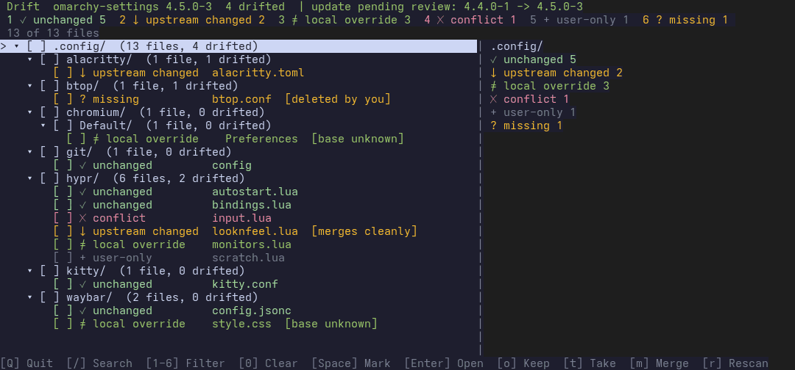

## Opening a diff

`Enter` on a file of the tree (or a double-click) opens its diff: base, yours and the package's side by side, with the hunks and the automatic result. `n` and `p` move between hunks, `Tab` moves between panes, `v` cycles the layouts (four panes, two panes, stacked), and `Esc` or `q` returns to the tree with the same selection. A file whose sides cannot be shown as text (not UTF-8, over 1 MiB or unreadable) is named in the notice line instead. The capture below is the real `drift` binary running on a scratch home directory with one edited file: it filters to local overrides, selects the file, opens the diff, cycles the layouts and goes back.

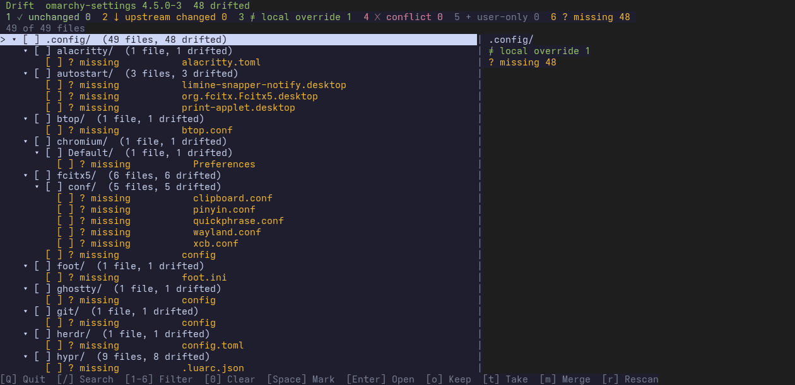

## Help and the command palette

`?` opens the help on any screen: every key of the current screen first, then the other screens and the keys that work everywhere, with `j`/`k`, `PageUp`/`PageDown` and `Home`/`End` to scroll and `Esc`, `q` or `?` to close. `:` opens the command palette: type part of an action's name, move with the arrow keys and press `Enter` to run it exactly as if you had pressed its key; the palette shows each action's keys beside it. Both are built from the same keymaps the screens use to handle keys, so a key that works is listed, and neither can drift from what the screens do. Both are unavailable while the first scan is still running and while you are typing a search, where `?` and `:` are ordinary characters. The capture below is the real `drift` binary on a scratch home directory: it opens the help, scrolls it, closes it, then opens the palette, filters to "filter loc" and runs the local override filter.

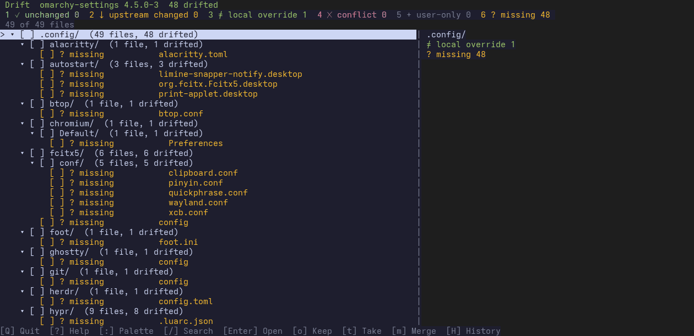

## Keys and the mouse

Every action has a key, and every action can be reached with the mouse. [docs/input-map.md](docs/input-map.md) lists each action with its keys and its mouse target, and a test regenerates that file from the keymaps and fails when it is out of date. The hint bar on every screen is clickable. The diff screen's bar offers Quit, Help, Palette, Write, Next hunk and Previous hunk, and the diff now answers the mouse in the stacked and two-pane layouts as well as the four-pane one. An action without a direct target is one click away in the command palette, which each screen opens from its hint bar. Tests click every cell of the tree, history and diff screens and fail if a click can ask for something no key can. The capture below is the real `drift` binary at 80×24 on a scratch home directory; the ring marks the hint that is clicked: Next hunk, then Write, which opens the plan, then Cancel.

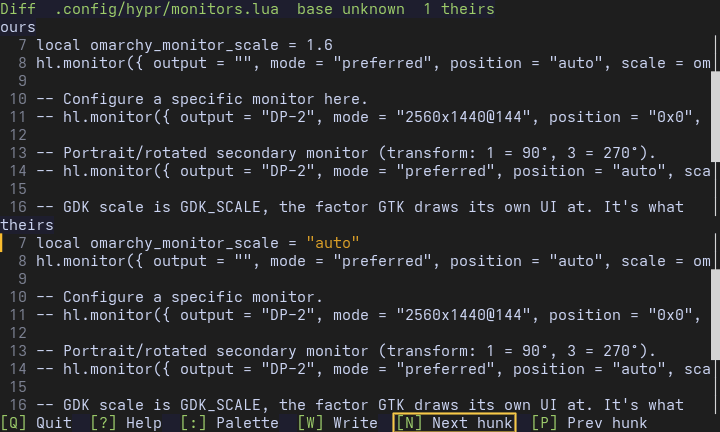

Text and status colours are checked for contrast against the dark Lunatui theme Drift runs in. Lunatui's light theme falls short on its accent and status colours, and Drift does not use it. The diff row tints and gutter marks are checked at 4.5:1 against the built-in hues and four Omarchy themes (dark, light, rose and grey) on both Lunatui themes; a gutter mark whose theme colour would vanish on its row is lightened or darkened until it reads.

## Empty and error states

Each screen says what is going on when there is nothing to list, and offers only the keys that can do something.

- **No drift.** When no file needs review the tree is replaced by "Nothing needs review", with a count per status (local overrides and user-only files are not drift) and the package version when one is waiting for review. The hint bar offers `R` Rescan and `H` History only, and the keys that act on a file (`Enter`, `o`, `t`, `m`, `i`, marking) do nothing, so nothing can be changed on a row you cannot see. `1` to `6` still list the files with one status; clearing the filter brings the message back.
- **No tracked files** and **no match.** An empty package file list, or a search or filter that matches nothing, is named as such. A filter or search that matches nothing shows what it was and the key that clears it.
- **Scan failed.** The reason is shown in full, wrapped, with the file it names, and the hint bar offers Rescan and History.
- **Notices.** A notice too long for the info line (for example an apply that stopped on one file) is shown in full beside the tree, or on the message screen. Errors from applying or undoing name the file and the reason, and a held update or package-database lock names the lock file.
- **History.** An empty history explains how a transaction is recorded; a history that could not be read shows the reason and offers Refresh. A transaction whose manifest cannot be read is listed with the manifest's path.
- **What each status means.** The summary pane explains the selected file's status and badge in a sentence, and pointing at a count in the header shows the same sentence on the info line.

The capture below is the real `drift` binary on a scratch home directory whose files all match the package: the no-drift screen, the unchanged files listed with `1`, back to the message with `1` again, the empty history, and finally a notice that names the unreadable state directory.

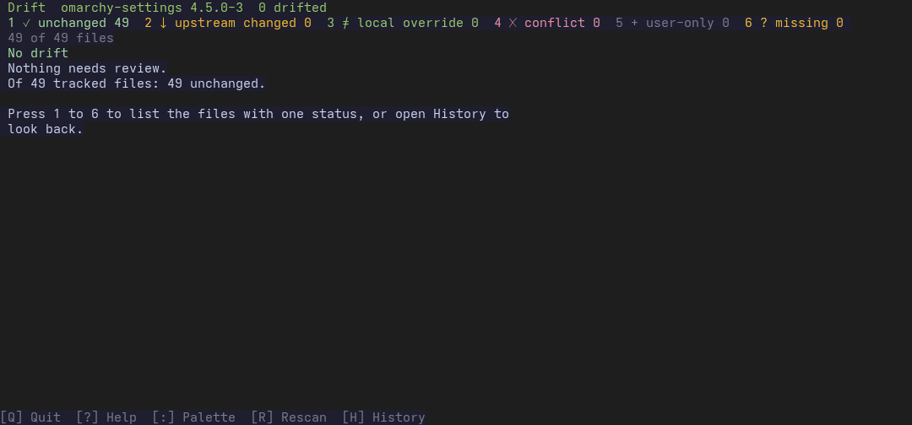

## Acting on files from the tree

On the tree screen, `o` (keep mine), `t` (take upstream) and `m` (merge) act on the marked files, or on the selected file or directory when nothing is marked (`Space` marks, `a` marks everything in the filter). The action opens the plan dialog; nothing is written until you confirm, all the files in one go go into one transaction, and the screen rescans afterwards. Files that cannot be acted on are named in the notice line. The capture below is the real review screen running `cargo run -p drift-tui --example tree_actions` on a sample report; its resolver only reports what it would write. It marks two files, takes upstream, expands a diff, moves focus to Confirm and confirms.

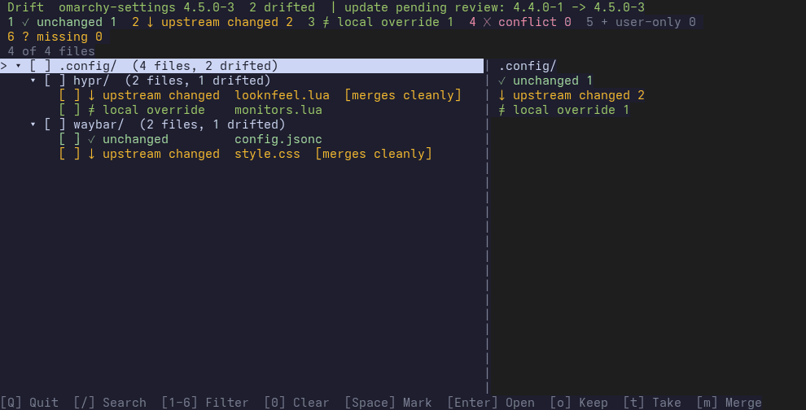

Undoing a resolution restores the file and the reviewed base it replaced, so an undone take upstream reads as upstream changed again.

## Safety model

- The first view is always a **read-only preview**. Opening Drift never writes configuration.
- A per-file **three-way diff** offers *keep*, *take upstream*, or *merge*. Those actions are explicit: nothing is applied until it is confirmed.
- Before any write, Drift takes a **backup** of the file it is about to change. An **undo** path restores that backup.
- New behavior ships **on by default**. A setting that is off by default is used only when the owner asks for one for that feature.

## Using it

Launch Drift from the Omarchy menu. The menu action is `omarchy-launch-or-focus-tui --app-id=TUI.float drift`, which opens the floating window, or focuses that window if it is already open. It is built for Omarchy 4.5 (Quattro), through the [Omarchy shell-plugin](https://github.com/basecamp/omarchy/blob/quattro/manual/32-shell-plugins.md) mechanism. Package templates are read from `/usr/share/omarchy`.

`drift notify` scans and, when configuration has drifted, sends a notification through `omarchy-notification-send`. One drifted file reads `1 config drifted`; more than one reads `N configs drifted`. The urgency is normal, and clicking the notification runs `omarchy-launch-or-focus-tui --app-id=TUI.float drift`, which opens Drift or focuses the existing window. Nothing is sent when the count is zero, while another process holds the Omarchy update lock, while the pacman database lock exists, or after `drift notify off`. The post-update hook inherits the Omarchy lock and still sends, and it still checks the pacman lock. An Omarchy lock file left behind does not block a later notify. Pacman removes its database lock when the transaction ends. Notifications are on until turned off. `drift notify on` turns them back on, and that choice is kept in Drift's state.

The bar widget in `plugin/` has id `drift.status`. It runs `drift status --bar` every five minutes. The JSON `text` field is the drifted count, and the widget hides when that field is empty. A click runs the same floating launcher. `omarchy plugin validate ./plugin` checks the folder. Place the folder in the user plugin directory as `drift.status`, then run `omarchy bar put drift.status`.

The interface is a path tree plus the per-file diff. Classification uses the installed package file list and, when available, a cache of the previous package version, so "matches template," "local override," and "conflicts with a new upstream change" stay distinct.

## Read-only commands

```sh
drift scan
drift status --json
drift status --bar
drift diff .config/hypr/hyprland.conf
drift diff "$HOME/.config/hypr/hyprland.conf" --json
```

`diff` accepts one tracked live path, relative to home or absolute under home.
It prints base provenance, status, base/ours/theirs contents, hunk kinds and the
automatic merge result. JSON includes each hunk's three sides. Conflicts have no
automatic result. Missing or unreadable sides are explicit; non-UTF-8 files and
files over 1 MiB show their hash and size instead of content.

`drift status --bar` prints one JSON object. `text` is the drifted count, or empty when nothing has drifted, so a status bar can hide the module at zero. `tooltip` names the count, `class` is `clean` or `drifted`.

Exit codes are 0 for no drift in the selected file, 1 for drift and 2 for an error,
including an unknown path. Local overrides and user-only files count as no drift,
matching `status`. These commands write no configuration or state.

## Resolving files

```sh
drift resolve .config/hypr/monitors.lua --keep
drift resolve .config/hypr/hyprland.conf .config/waybar/style.css --upstream --dry-run
drift resolve "$HOME/.config/hypr/looknfeel.lua" --merge --yes
```

`resolve` shows a plan (each file, its action, the backup location and a diff summary) and writes only after you answer `y`; `--yes` skips the question, `--dry-run` only prints the plan, and without a terminal nothing is written unless `--yes` is given. All files in one call go into one transaction.

- `--keep` (keep mine) writes no configuration. It records the shipped template as the reviewed base, so the file reads as an acknowledged local override and stays that way after a rescan.
- `--upstream` (take upstream) replaces the file with the template, or creates it when it is missing, after backing up the original.
- `--merge` applies a three-way merge when it has no conflicting hunks. Files with conflicts, no known base, non-text content or only local changes are skipped and named.

Symlinks, files an app rewrites, files without a template and files already equal to upstream are skipped with a reason. A write under `~/.config/hypr` is followed by `hyprctl configerrors`, and Drift offers to undo the transaction if Hyprland reports errors.

## History and undo

```sh
drift history
drift history --json
drift undo --dry-run
drift undo <transaction> --yes
drift undo --force .config/waybar/config.jsonc --dry-run
```

`history` lists the transactions Drift has written, newest first: id, time, package version, file count and what was done. `undo` previews what undoing a transaction (the newest by default) would restore or remove, and writes only after you answer `y`; `--yes` skips the question, `--dry-run` only prints the preview, and without a terminal nothing is written unless `--yes` is given. Undoing also puts back the reviewed bases the transaction replaced, so an undone take upstream reads as upstream changed again and an undone keep mine is no longer acknowledged. The undo is a transaction of its own and can be undone in turn.

A file that changed after the transaction is left alone and named; `--force <path>` restores it anyway. Files the transaction left as they were are listed and skipped.

On the tree screen `H` opens the same list. `Enter` asks to undo the selected transaction through the plan dialog, `U` also restores files that changed since, `r` reloads, and `q` goes back. The screen and the command write the same transaction. The capture below is the real `drift` binary running against a scratch home directory: it opens the history, selects a take upstream, reads the plan and confirms.

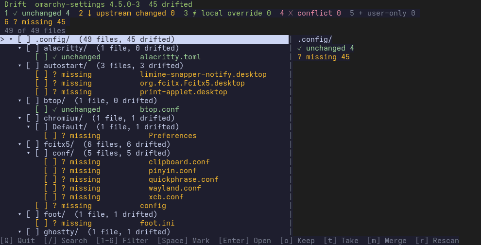

## Package snapshot

`drift snapshot --pre` copies the installed template roots into `/var/lib/drift/snapshots/<version>/` before an `omarchy-settings` upgrade. Pacman runs it from a PreTransaction hook. The command writes only under that store. A failure exits 2 and does not stop the upgrade.

## Upgrade notice

After that upgrade, a PostTransaction hook writes a UTC stamp to `/var/lib/drift/updated` and nowhere else. The stamp is world-readable, and its directory is traversable, so a user session can watch it. The packaged user path unit watches the stamp. It keeps running when the file is missing. A change starts a oneshot that waits until `/var/lib/pacman/db.lck` is gone and then runs `drift notify` once. That wait does not give up while the lock remains, and the service does not abandon it on a start timeout. During `omarchy-update` that oneshot does not send a second notice: the update still holds its lock, and `~/.config/omarchy/hooks/post-update.d/drift` (installed by `drift integrate`) is what runs `drift notify`.

## Development

Rust 1.99.1, pinned by `rust-toolchain.toml`. From this repository:

```bash
cargo test
cargo fmt --all --check
cargo clippy --all-targets --all-features -- -D warnings
cargo xtask check
cargo deny check
```

See the [review policy](REVIEW_POLICY.md) for PR classification, proof, and merge requirements. Pull requests that add or change a visible widget or TUI view must include a README GIF or WebP captured from real program output.
